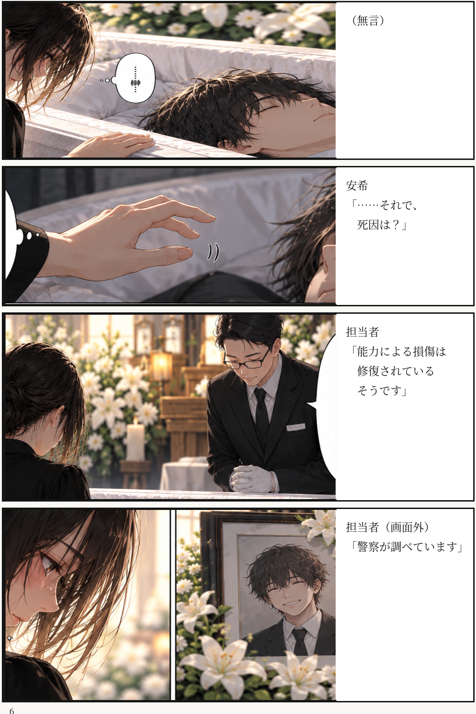
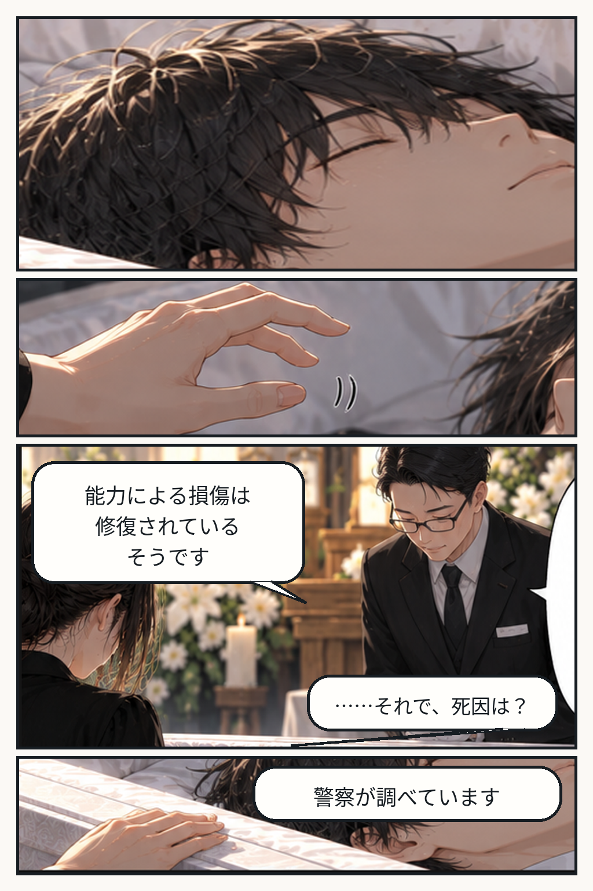
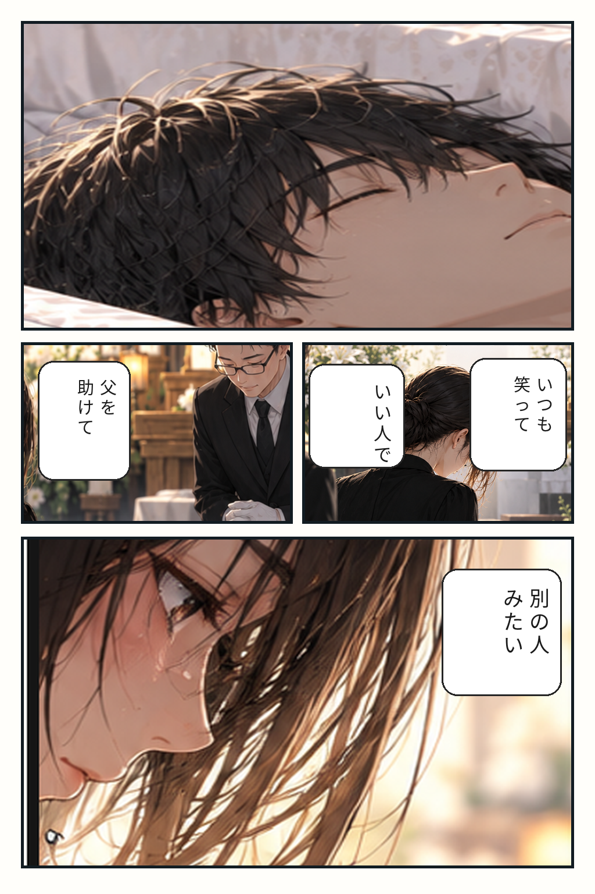
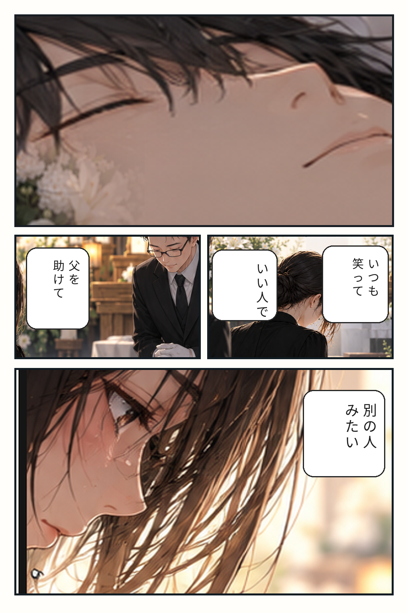
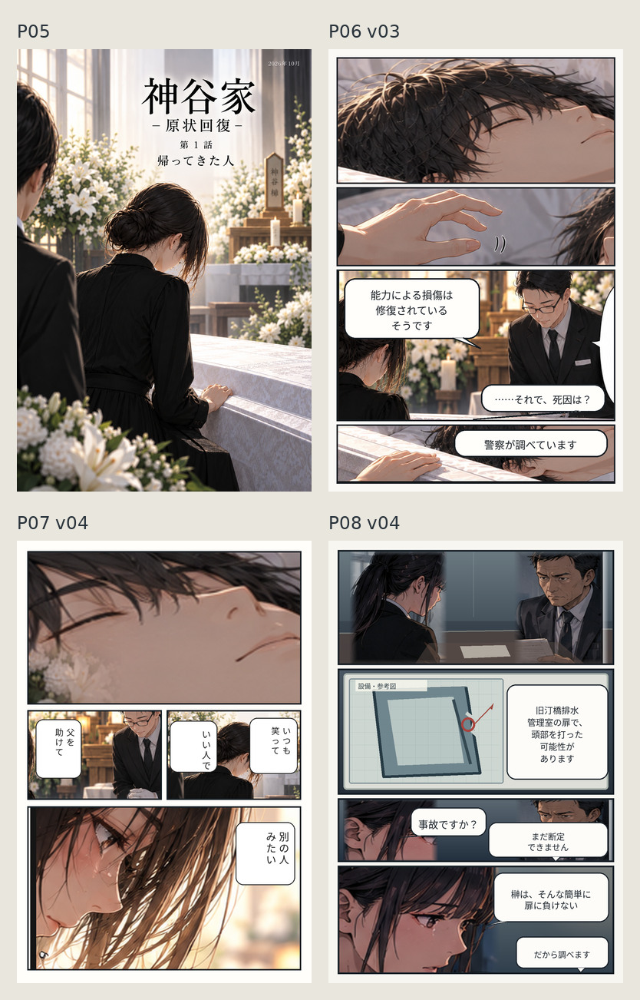
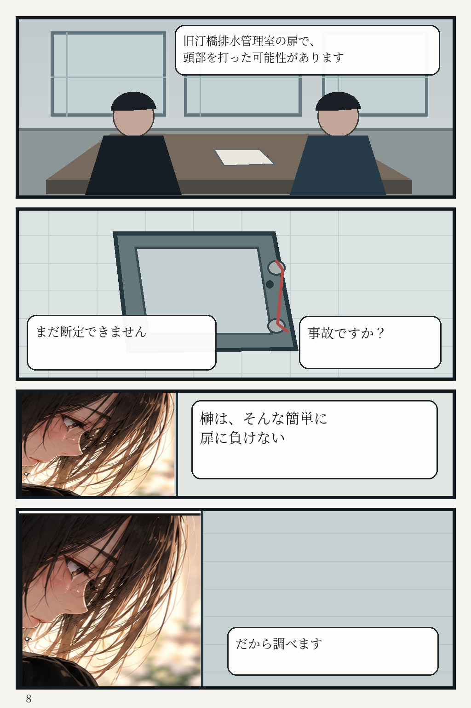
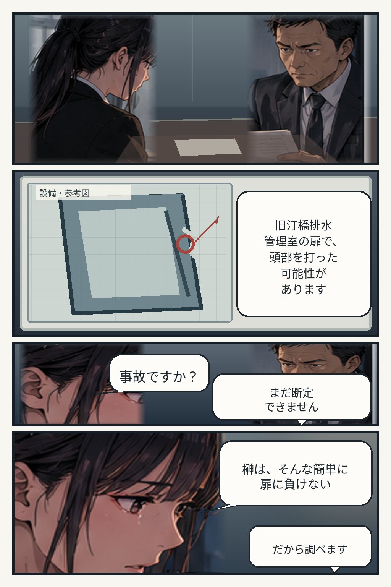

# 第1話 — カラー原稿／混合作画候補（PNG原本保存）

このフォルダは**AI生成カラーPNG原本と、その素材から再構成したカラー原稿候補**を区別して保存する。元画像は画素を変えずにGitHubへ登録。`pNN_vXX.png` は切り出し・組版・一部の補助作画を行った別ファイルであり、原本そのものではない。**いずれも最終完成承認を意味しない。**

## 登録画像

### P05 — 葬儀のタイトルページ（暫定採用候補）

### P06 — 無傷（暫定採用候補）

### P06 v03 — 「無傷」4コマ再構成（新規レビュー候補）

- [P06 v03 PNG原稿](./p06_v03.png)／[出力検証マニフェスト](./revision-manifest.json)。
- 既存のカラーP06・P07のPNGをGitHub Actions内で読み込み、P06の4コマに再構成。原本は**上書きしていない**。
- 遺体の無言コマ、触れずに止まる手、担当者の能力損傷の修復説明、安希の死因質問、警察の調査中という答えを独立した画面に配置。
- 台詞は既存画に生成させず、`scripts/render_episode01_p06_v03.py` から組版。画像寸法・SHA-256・原本ハッシュをワークフローで検証。
- **採用状態は `candidate-needs-visual-review`。** P06原本の `provisional` 判定は変更していない。P06 v03は棺の顔がP07冒頭の構図と重なるため、通読時に重複感がないか確認が必要。

### P07 — キャンディーがない（v03・暫定採用候補）

### P07 v04 — 口元寄りのカラー修正版（レビュー候補）

- [P07 v04 原稿](./p07_v04.png)／[再合成スクリプト](../../../../../scripts/render_episode01_p07_v04.py)／[検証マニフェスト](./revision-manifest.json)。
- P06 v03では榊の顔全体、P07 v04ではキャンディーのない口元を強く寄せて描き、**連続ページの構図の重複を減らした**。
- 白い花は既存のP05カラー原稿から前景素材を取り、境界をぼかして組版した。
- P07原本の下3コマの画素を変更しておらず、**「父を助けて」「いい人で」「いつも笑って」「別の人みたい」**の台詞も維持。
- 元の `p07.png` は暫定採用のまま保持し、v04は `candidate-needs-visual-review`。完成採用ではない。

### P05〜P08の連続レビュー

[P05〜P08の通読レビュー記録](./REVIEW_P05_P08_2026-10-20.md)。特にP08の模式図とP05〜P07の人物作画との画風差が、次の本作画で優先する課題。

### P08 — 扉（v03・レビュー前、混合作画）

### P08 v04 — 「扉」カラー4コマ再構成（新規レビュー候補）

- [P08 v04 PNG原稿](./p08_v04.png) ／ [作画素材（生成済みインタビューシーン）](./sources/p08_interview_montage.png) ／ [再合成スクリプト](../../../../../scripts/render_episode01_p08_v04.py)。
- [GitHub Actionsによる再描画・原本検証（成功）](https://github.com/hansuoi/story-gods-ai/actions/runs/39376757317) ／ [出力マニフェスト](./revision-manifest.json)。
- P08 v03の人物が模式図に見える問題を優先して改修。実画像の人物はカラーの安希と刑事を使用し、**設備参考図だけ**図解表現を残した。
- ネームの4コマ構成（面談全景 → 扉の図 → 事故かどうかの問答 → 安希の強い否定）と台詞を日本語で独立組版。生成元の誤った台詞は採用していない。
- 元の `p08.png` は**上書きしない**。v04は `candidate-needs-visual-review`。人物と画風の連続性を含め、最終採用は未判定。

[改訂後のP05〜P08カラー通読画像](./review_p05_p08.jpg)を確認し、[P08 v04作画・通読レビュー](./REVIEW_P08_V04_2026-10-20.md)を参照。

## P09〜P16：カラー候補

[7ページの通読画像（P09〜P15）](./review_p09_p15.jpg) ／ [最初のP09〜P15レビュー](./REVIEW_P09_P15_2026-10-25.md) ／ [P13〜P16の改訂レビュー](./REVIEW_P13_P16_2026-10-25.md)

| ページ | 現時点の優先候補 | 状態 |
| --- | --- | --- |
| P09「いつもあったもの」 | [p09_v01.png](./p09_v01.png) | 靴箱の空白の表現は再作画対象 |
| P10「返事のない人」 | [p10_v01.png](./p10_v01.png) | 止まる手と二席の構図は再作画対象 |
| P11「受付」 | [p11_v01.png](./p11_v01.png) | 白シャツ・電卓の合成品質は未解決 |
| P12「空欄の予定」 | [p12_v01.png](./p12_v01.png) | 日付の矛盾部分は除外。領収書の時刻が未表示 |
| P13「2018」 | [p13_v02.png](./p13_v02.png) | v01を維持しつつ、水害住所一覧を追加した新候補 |
| P14「連絡」 | [p14_v02.png](./p14_v02.png) | 写真素材の安希・刑事を使用した新候補 |
| P15「それでも行く」 | [p15_v02.png](./p15_v02.png) | 施錠用の鍵と高架下の安希の遠景を新素材に更新 |
| P16「現場」 | [p16_v01.png](./p16_v01.png) | 旧汀橋管理室・金具・見えない相手の声を描いた新候補 |

すべて `candidate-needs-visual-review`。過去版の `p13_v01.png`、`p14_v01.png`、`p15_v01.png` は**比較資料として保存**し、勝手に最終採用扱いへ昇格しない。

### カラー素材と再生成

- [P09〜P12のAI生成原本](./sources/p09_p12_generated_montage.png)／[原本からP09・P10・P13 v01を再構成](../../../../../scripts/render_episode01_p09_p10.py)／[P11・P12](../../../../../scripts/render_episode01_p11_p12.py)／[P14・P15 v01](../../../../../scripts/render_episode01_p14_p15.py)。
- [P13〜P16のAI生成原本](./sources/p13_p16_generated_montage.png)／[P13〜P15 v02とP16 v01の再構成スクリプト](../../../../../scripts/render_episode01_p13_p16.py)。
- [全改訂版のSHA-256／サイズ／出典マニフェスト](./revision-manifest.json)。原本のハッシュ照合・画像の1024×1536検証はGitHub Actionsで実施。

## 原本の完全性と採用基準

- [原本PNGの検証マニフェスト](./manifest.json)：4画像の元ファイル名、サイズ、SHA-256、Git Blob SHA、候補の採用状態を記録。
- GitHubで登録済みのBlob SHAはローカル原本のGit Object SHA-1と一致し、PNGに再エンコード・圧縮・リサイズを加えていない。
- 元画像の位置付け：P05/P06/P07は `provisional`（暫定採用）候補。P06 v03・P07 v04・P08原本・P08 v04は `candidate` であり、**正式採用済みの原稿はまだない**。
- P08は人物を写真風に描き切った原稿ではなく、資料図を含む混合作画候補。
- 第1話全体の制作進捗を数える際は、[ベクター作画候補32枚](../vector-candidates/READTHROUGH.md)と**カラー原本4枚と別途再構成したカラー候補（P06〜P16）**を混同しない。双方とも正式完成原稿の枚数ではない。

## 次の本作画対象

- GitHubで確認できたカラー候補はP16まで。次の未制作カラー原稿は**P17「最初の顔」**（凪の初登場、安希の説明、凪の動揺、青い糸付き安全ピン）。
- P17以降も、**画像原本のGitHub保存 → 台詞の独立組版 → レンダリングとハッシュ検証 → 通読レビュー**の順で管理する。画像の保存だけでは正式採用にしない。

## 継続する制作手順

1. PNG原本をモデルの作業領域へ生成・保存し、画素寸法・SHA-256とGit Blob SHA-1を記録。
2. 元PNGのバイト列をbase64へ変換し、一時的にChatGPT Libraryを受け渡し経路として使用。
3. GitHub Git Data APIでbase64を復元したBlobを作成し、親コミットのTreeからパスを追加する。
4. `main` ブランチに非強制のfast-forwardで登録し、GitHub上のファイルのサイズ・Blob SHAが元画像と一致することを確認。
5. 一時転送ファイルを削除し、マニフェストとページ単位の品質レビューを更新する。

**重要**：この手順は実際にP05〜P08で成功。外部の画像ホスティングや、別物のベクター置換を必要としない。

参考：[全32ページの通読ビュー](../vector-candidates/READTHROUGH.md) ／ [制作プロセス](../PRODUCTION_PROCESS.md)

## GitHub内でのカラー原稿再合成（検証済み）

P06〜P16のカラー改訂版では、すでにGitHubに登録したPNG素材を使用し、すでにGitHubに登録した原本PNGをActions上で直接処理し、生成PNGをそのままコミットできた。以後、元画と文字組みを分離したページの改訂には、この再合成方式を使える。再合成可能であることと作品品質の採用判定は別扱いにする。

- [P06再合成スクリプト](../../../../../scripts/render_episode01_p06_v03.py)
- [P07再合成スクリプト](../../../../../scripts/render_episode01_p07_v04.py)
- [P08再合成スクリプト](../../../../../scripts/render_episode01_p08_v04.py)
- [カラー4ページ組プレビュー生成スクリプト](../../../../../scripts/render_episode01_color_readthrough.py)
- [GitHub Actionsワークフロー](../../../../../.github/workflows/render-episode01-color-revisions.yml)
