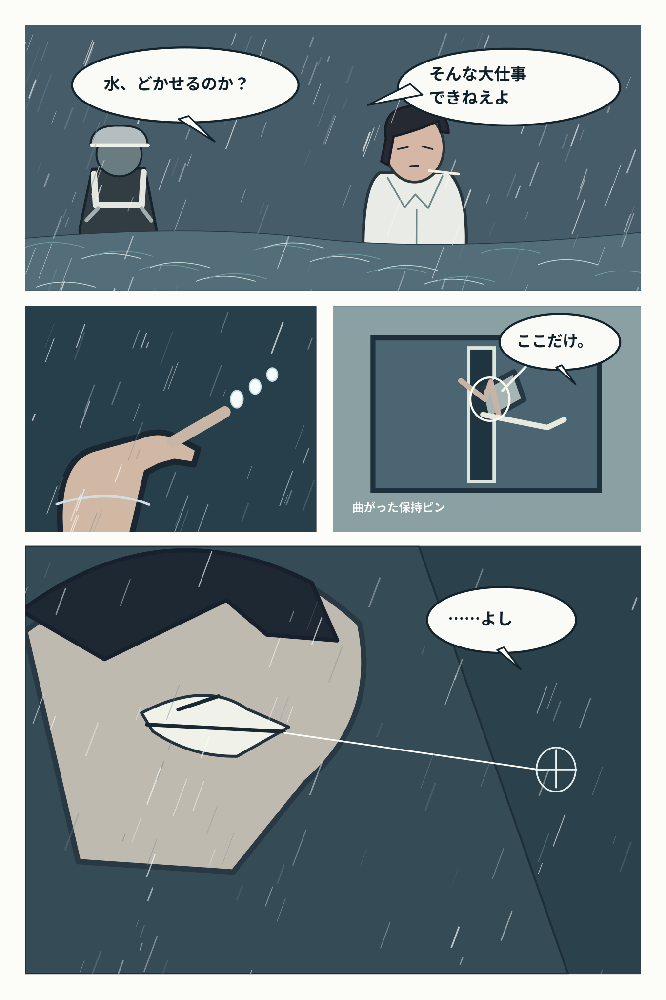
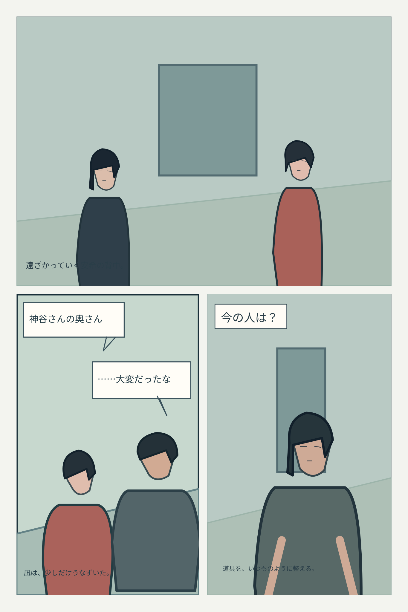
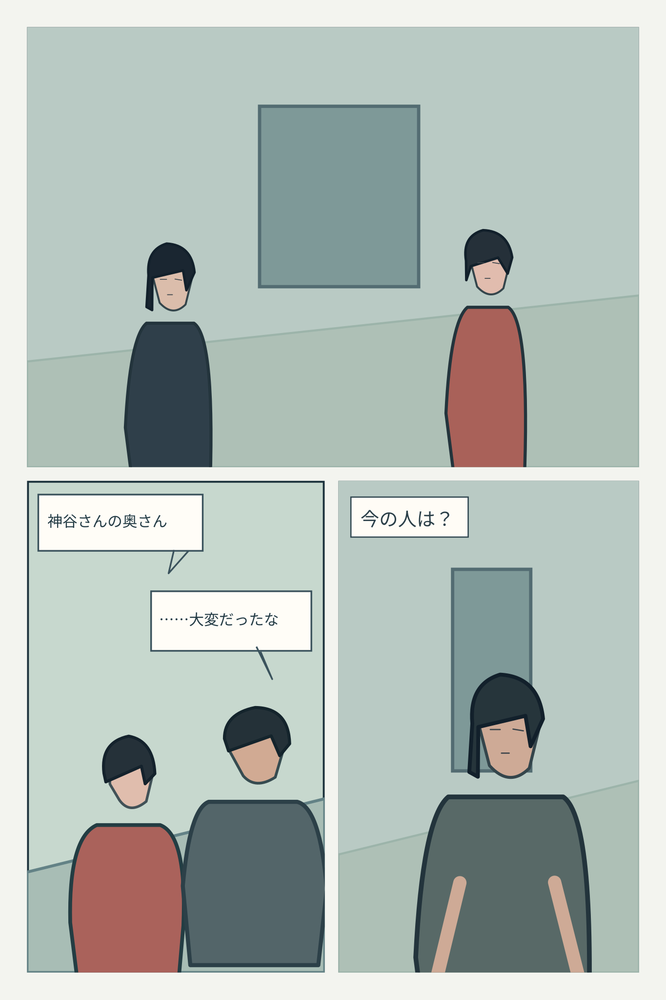
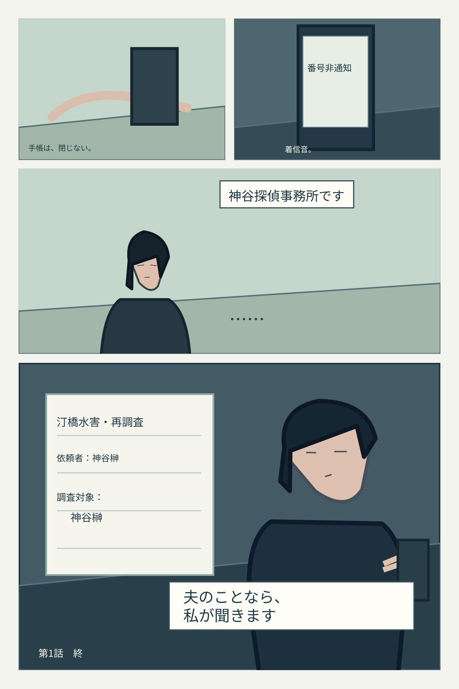

# 台詞整理前後の比較（2026-10-15）

完成採用のための比較素材。編集前のSVGも保持し、どちらが面白いかを実画面で確認する。

### P02／水滴を撃つ直前

改稿前：『次の瞬間へ。』という、読者の読書動作を言葉で誘導する説明がある。

改稿後：次のページへ進みたくなるかを、照準と手の動作だけで成立させる。

### P25／久住の第一印象

### P32／電話を受ける安希

**評価:** プレビューの存在と採否は別。人物の顔の線画・遠近・活字の大きさを改善しない限り、作品全体を完成原稿とは呼ばない。
