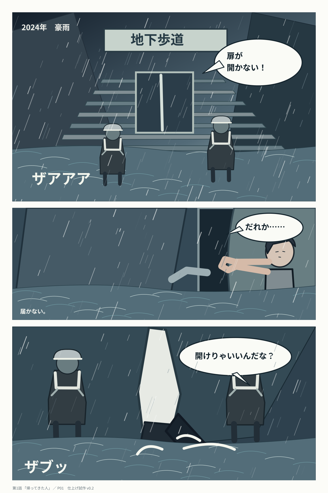
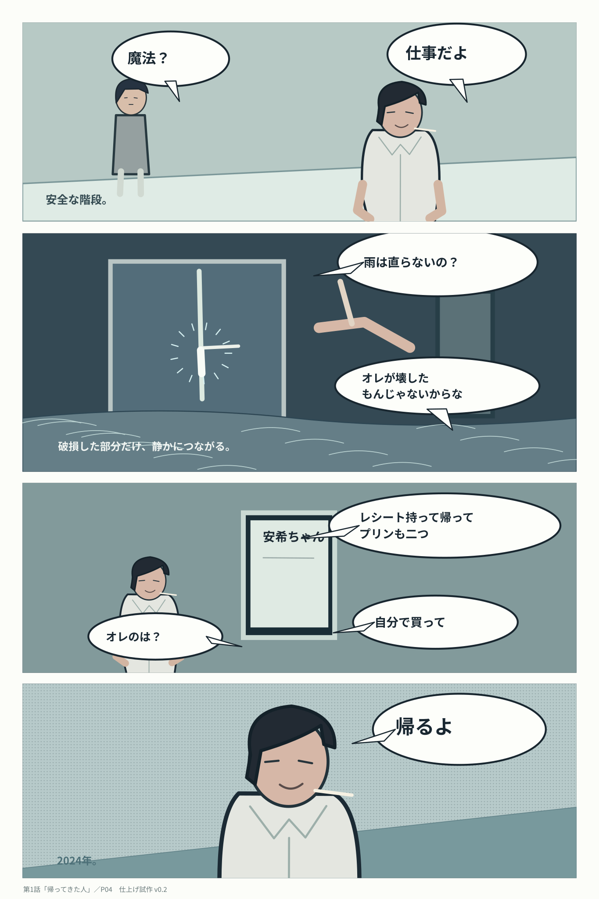
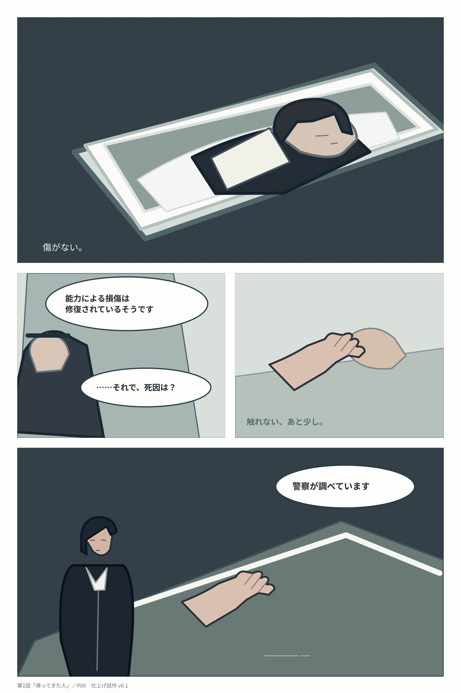
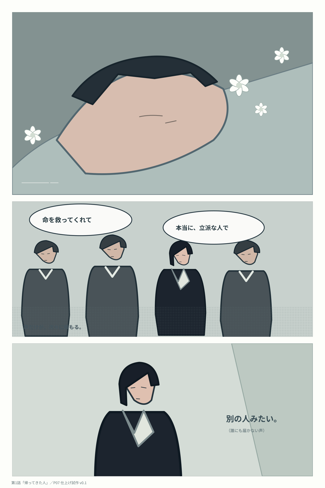

# 第1話「帰ってきた人」P01～P12｜仕上げ試作・連続ビュー

**清書試作／完成原稿ではない。** 2024年の地下歩道の救助から、2026年10月の葬儀・警察の説明へと連続で閲覧する。各SVGは独立した1600×2400px相当の編集可能な画面。

[制作判定](README.md) ／ [脚本](../../../scripts/episode-01.md) ／ [文字ネーム](../../../name/episode-01.md) ／ [構図ラフ全32ページ](../gallery.md)

### P01：届かない手（2024年）

### P02：数滴（保持ピンを狙う）

### P03：ピン（救助員たちが扉を開く）

### P04：「帰るよ」（壊した箇所だけ修復）

### P05：帰ってきた人（2026年10月）

### P06：無傷の遺体

### P07：いつものキャンディーがない

### P08：扉で死んだのか

### P09：空いた靴の場所

### P10：返事のない椅子

### P11：白いシャツのある受付

### P12：空欄の予定

---

ここまでで「2024年：帰るよ」→「2026年：棺」→「榊はそんな簡単に扉に負けない」の変化を12ページで確認できる。ただし人物の描線・金具の機構・手の可動域・視線が弱く、入稿原稿の品質にはまだ到達していない。P13以降は[構図ラフ版](../gallery.md)に続く。
