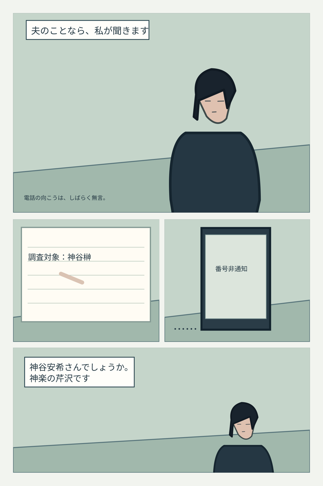
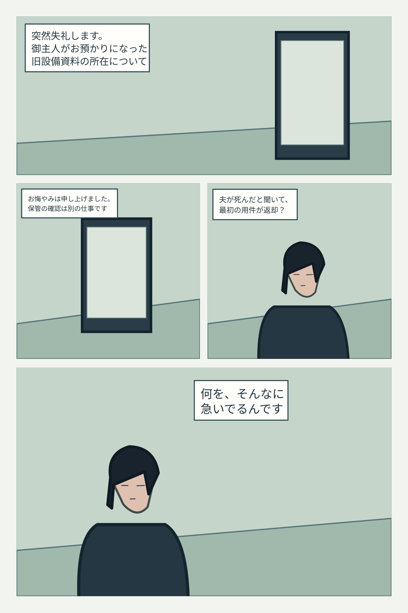
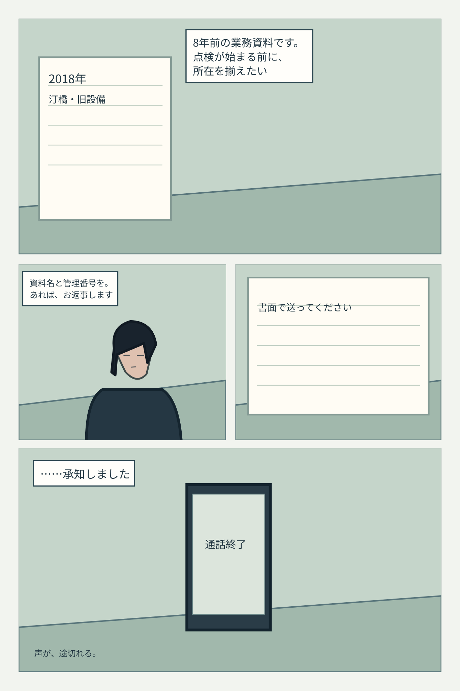
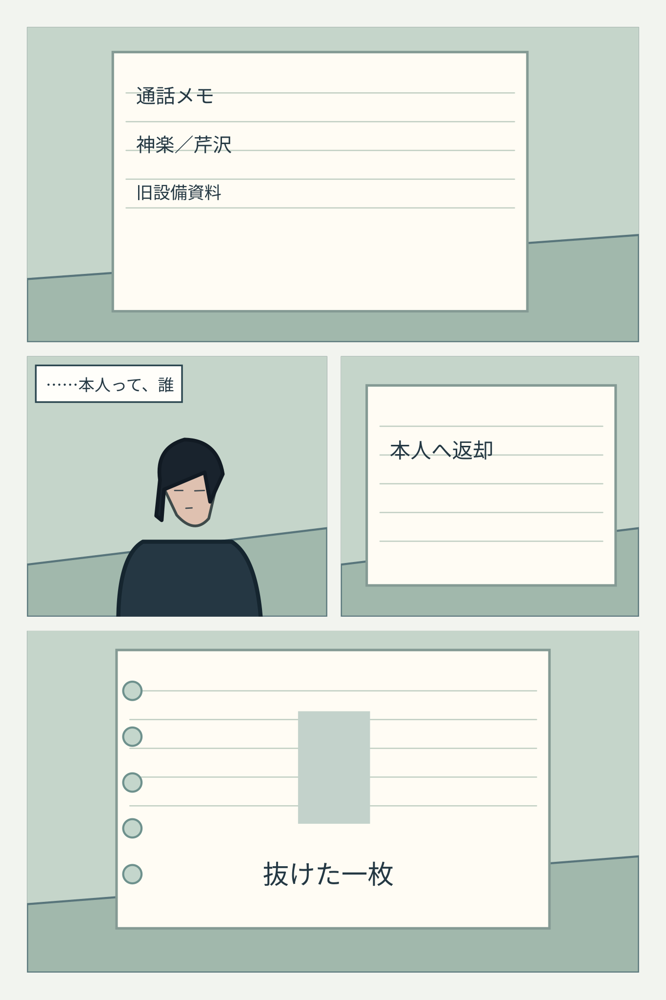
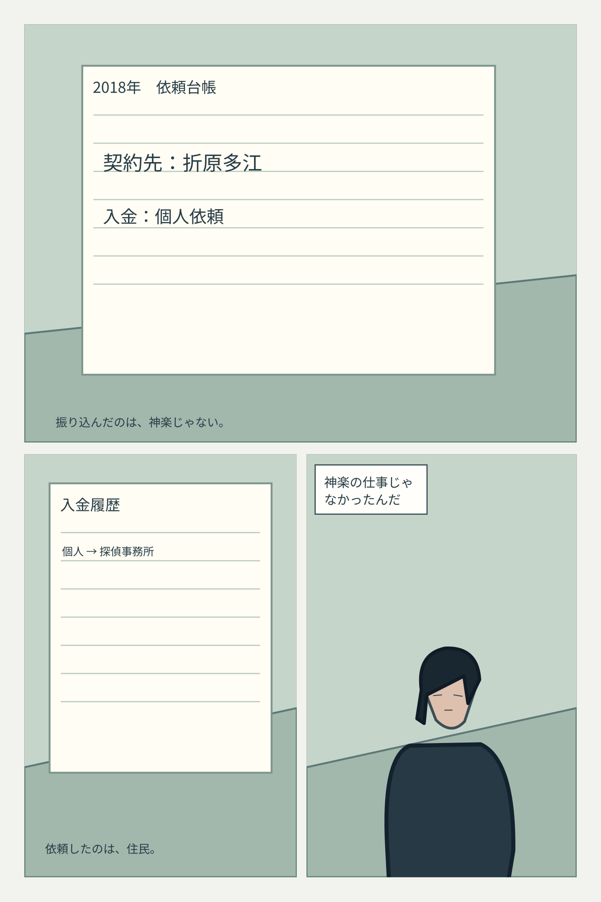
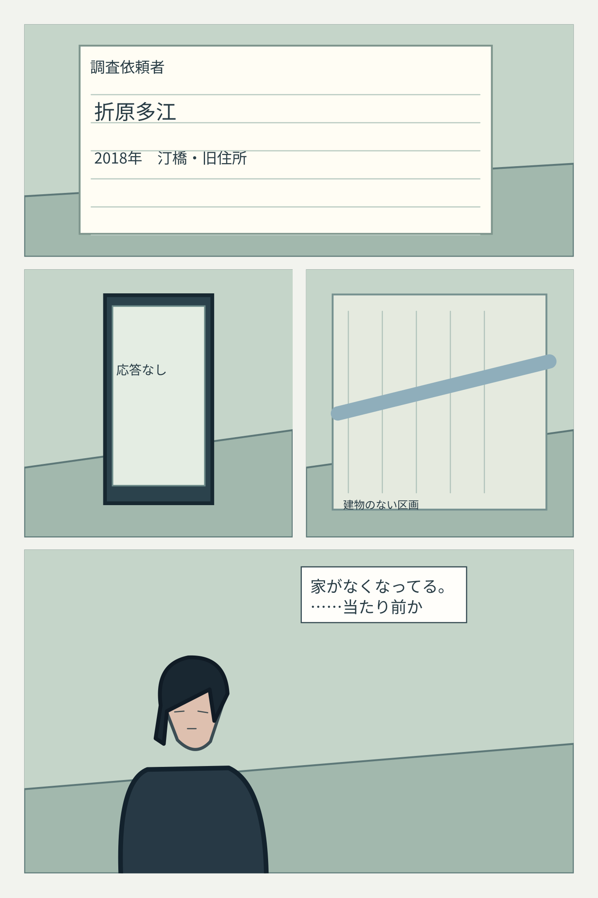
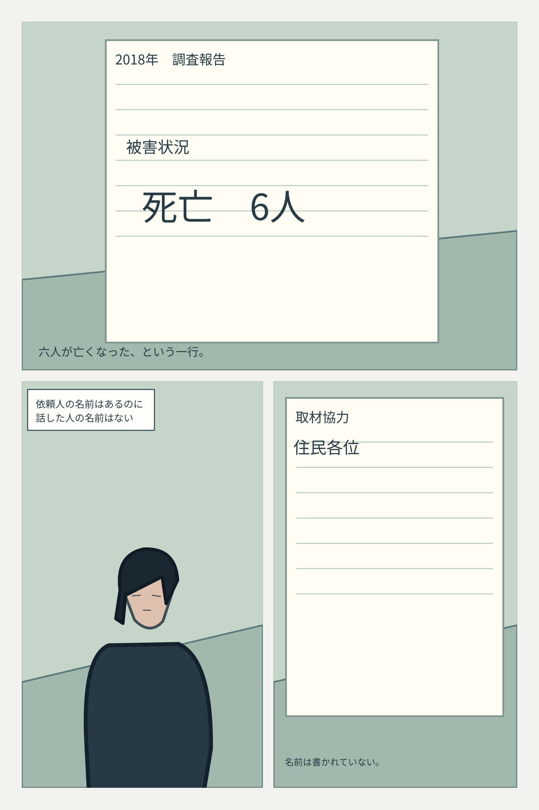
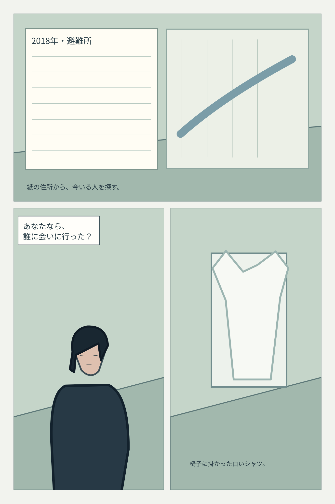

# 第2話「名前のない電話」P01～P08｜仕上げ試作・連続ビュー

**構図ラフより描き込んだSVG試作だが、完成原稿ではない。** 第1話の末尾から電話を受け、翌朝、安希が住民を探しに行くまで。

[第1話・仕上げ試作32ページ](../../episode-01/finish/reader.md) ／ [制作状況](README.md) ／ [第2話・構図ラフ32ページ](../gallery.md)

### P01 非通知の返答

### P02 芹沢からの資料照会

### P03 管理番号を求める

### P04 本人へ返却

### P05 住民による依頼

### P06 消えた旧住所

### P07 六人と無記名

### P08 白いシャツ

P09～P32は現時点では[構図ラフ](../gallery.md)で確認できる。第2話の完成採用は0ページ。
